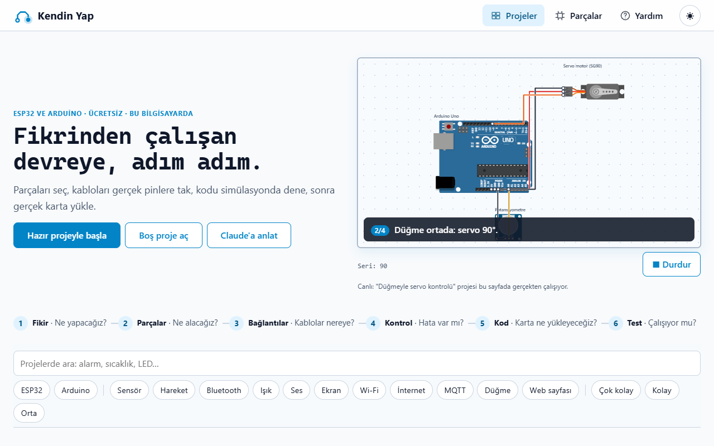
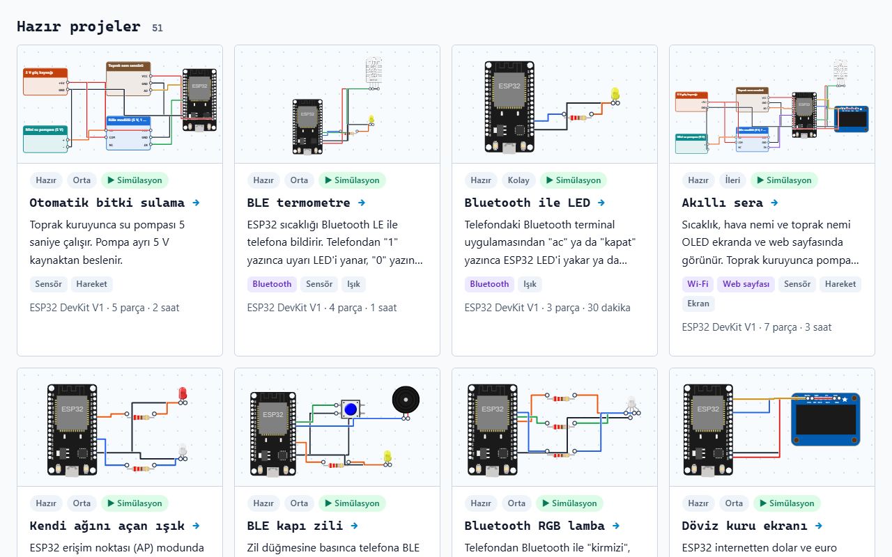
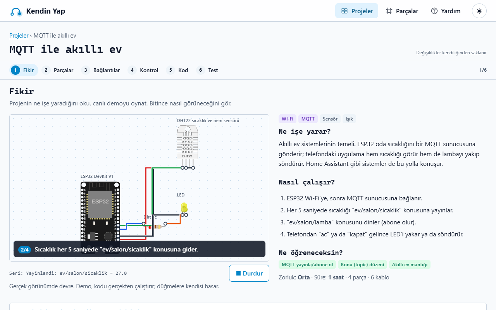
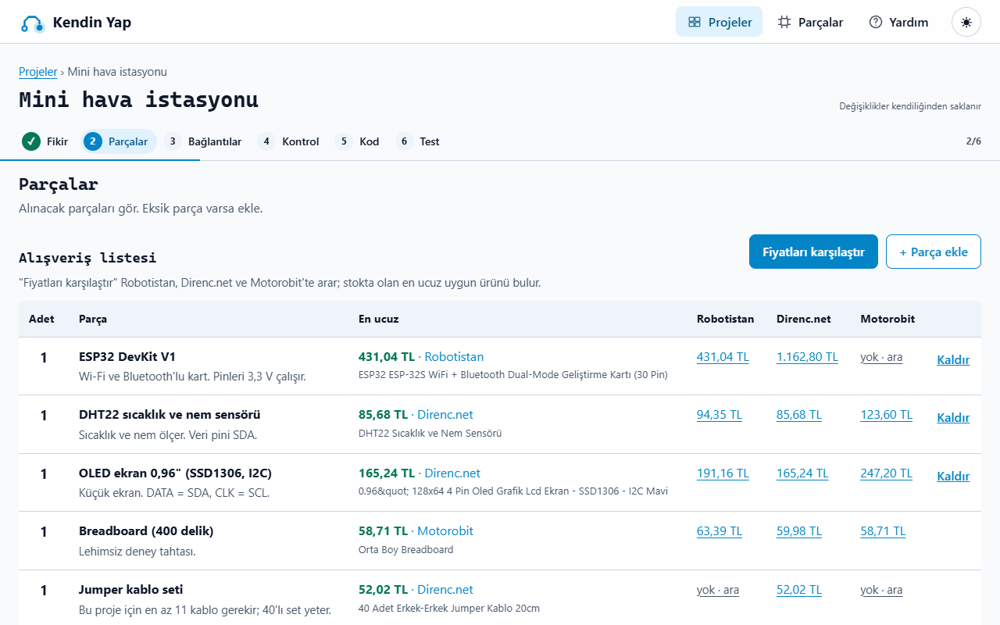
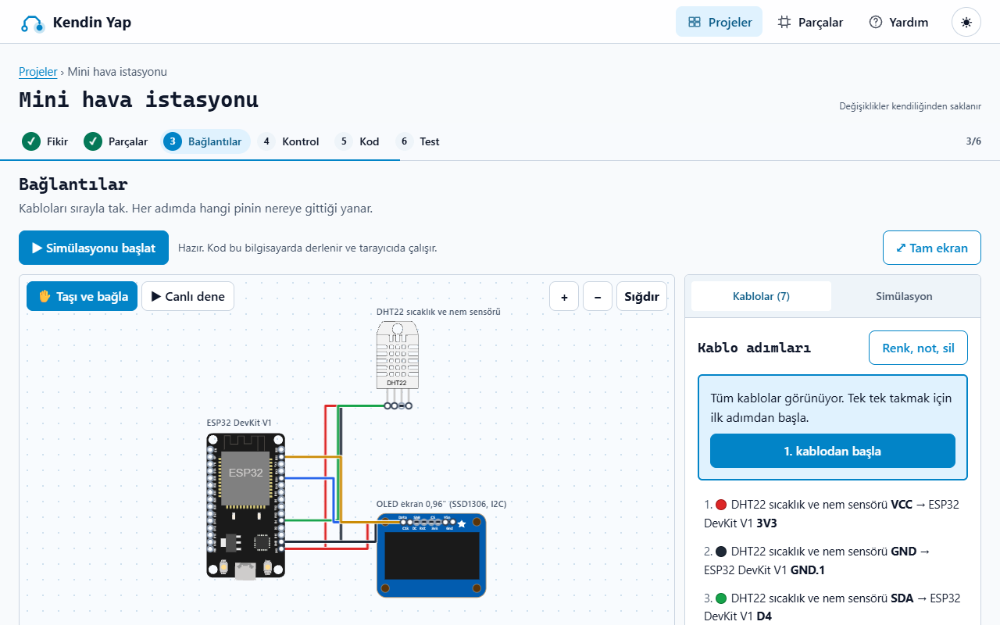
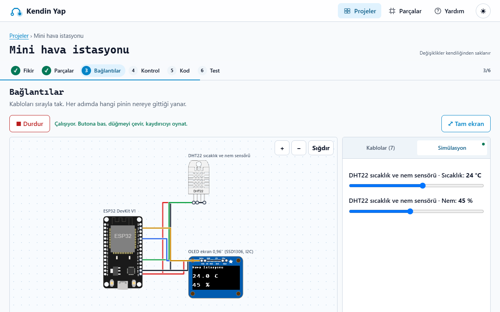
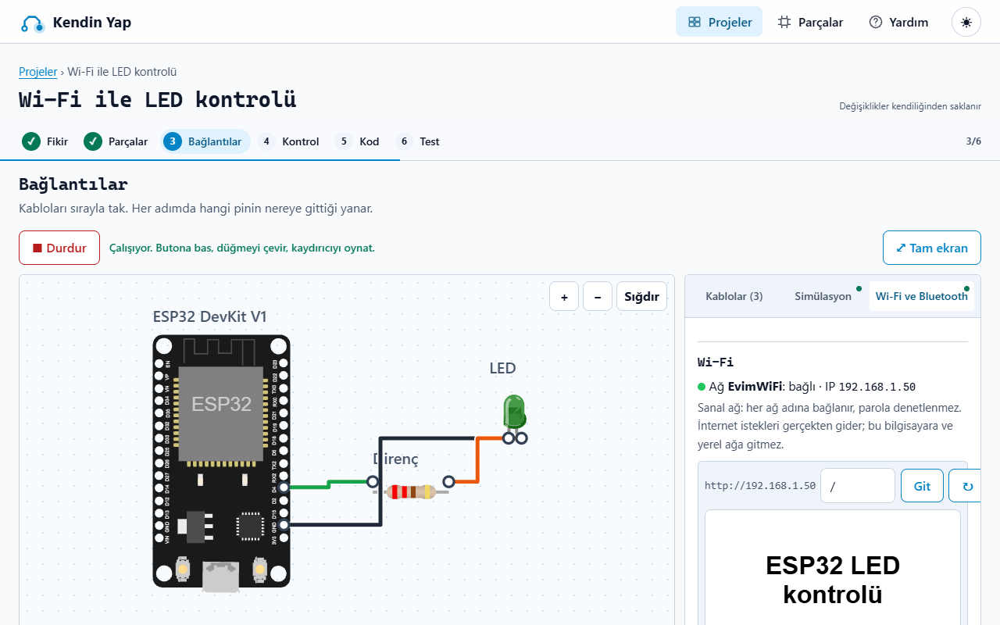
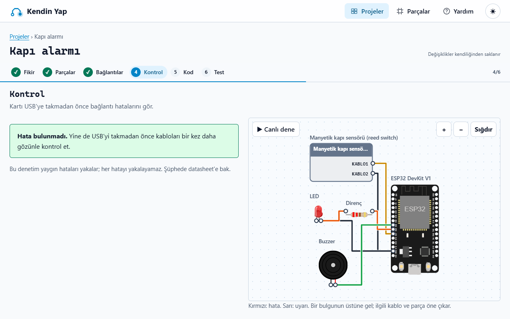
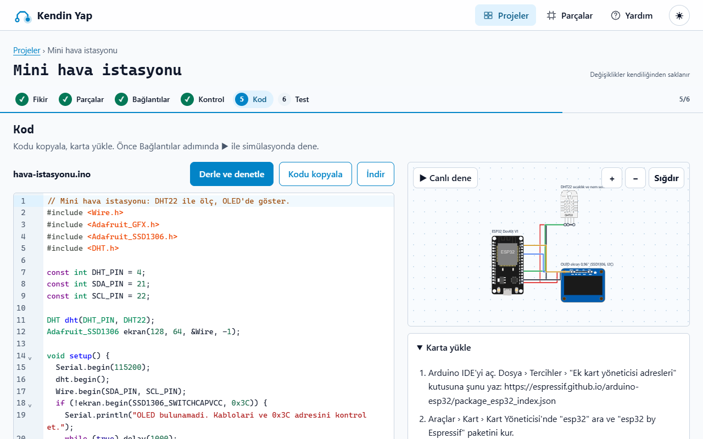
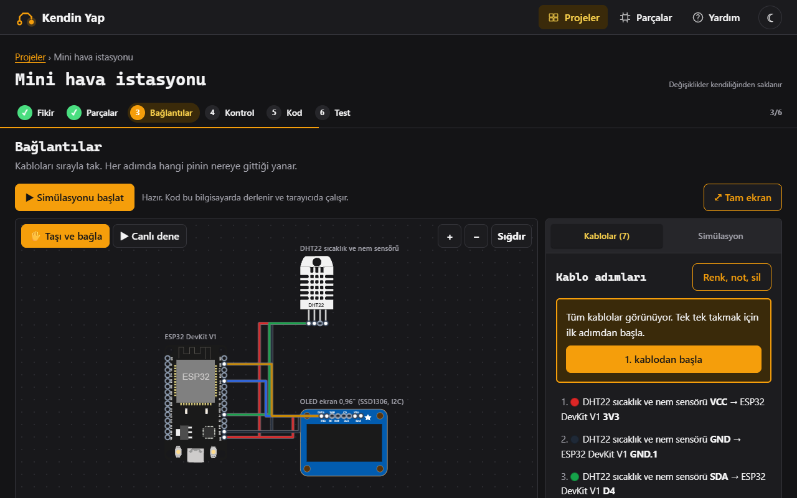

# Kendin Yap

ESP32 ve Arduino projelerini fikirden çalışan devreye adım adım kuran yerel web sitesi. Ücretsiz; hesap yok.



## Ekran görüntüleri

| Hazır projeler | Proje tanıtımı ve canlı demo |
|---|---|
|  |  |

| Parçalar ve mağaza fiyatları | Bağlantılar: etkileşimli şema |
|---|---|
|  |  |

| ESP32 simülasyonu: DHT22 + OLED | Wi-Fi: ESP32'nin web sayfası |
|---|---|
|  |  |

| Kontrol: bağlantı denetimi | Kod: CodeMirror ve pin vurgusu |
|---|---|
|  |  |

Koyu tema (Grafit):



## Başlatma

- `Başlat.cmd` dosyasını çift tıkla. Site `http://127.0.0.1:8200/` adresinde açılır.
- Ya da: `npm install`, sonra `npm run dev`.
- Port 8200 dolu olursa site açılmaz (`strictPort`). Bu makinede 8000, 1984, 8554, 8555 canlı IyexVMS'e ayrılmıştır; bunları kullanma.

## Neler var?

| Özellik | Nerede |
|---|---|
| 51 hazır proje, Çok kolay'dan İleri'ye: LED, buton, sensör, servo, röle, web sunucusu, MQTT, Bluetooth, BLE, internetten veri. 41'i simülasyonda çalışır; 10'u (LCD, tuş takımı, gaz, alev, ses, IR, RTC, joystick, terazi, 7 segment) gerçek devre için şema, kod ve adımlarla gelir | Ana sayfa |
| Proje vitrini: kartta devre resmi ve özellik etiketleri; ilk adımda "Ne işe yarar / Nasıl çalışır / Ne öğreneceksin" ve kendi kendine oynayan canlı demo | Ana sayfa, Fikir |
| Her proje 6 adım: Fikir, Parçalar, Bağlantılar, Kontrol, Kod, Test | Proje sayfası |
| Gerçek görünüşlü etkileşimli şema: pin adı, bağlandığı yer, adım adım kablo | Bağlantılar |
| Parçayı sürükle, iki pine tıklayarak kablo çiz; "Canlı dene" ile buton ve düğmeyi oynat | Bağlantılar |
| Simülasyon (ESP32, Uno, Nano): kod yerelde derlenir, tarayıcıda çalışır; LED, RGB LED, buzzer, servo, buton, anahtar, potansiyometre, HC-SR04, PIR, LDR, NTC, DHT22, OLED, röle modülü, pompa, toprak nemi, kapı sensörü, seri ekran | Bağlantılar › ▶ Simülasyonu başlat |
| Fiyat karşılaştırma: Robotistan, Direnc.net, Motorobit; en ucuz ürün ve tek mağaza toplamı | Parçalar › Fiyatları karşılaştır |
| Bağlantı denetimi: kısa devre, 5 V → 3,3 V pin, yalnız giriş pini, direnç yok, ortak GND yok… | Kontrol |
| Kod, kablolardan üretilen pin tanımları, yükleme adımları, Wokwi'de ücretsiz simülasyon | Kod |
| Montaj ve test listesi, ilerleme, proje dosyasını indirme, yazdırma | Test |
| 40+ parçanın görünümü ve pin açıklamaları | Parçalar sayfası |

## Tasarım kuralları

- Renk, yazı ölçeği (`--yazi-*`), 8 piksellik boşluk (`--b1`…`--b7`) ve hareket (`--sure-kisa` 150 ms, `--sure-orta` 200 ms, `--sure-uzun` 320 ms, `--egri`) `src/stil.css` başındaki değişkenlerde.
- Tema: sistem / açık / koyu (üst çubuktaki düğme, `localStorage: ky.tema`). Açık tema "Teknik çizim" (gök mavisi `#0284c7`, eş aralıklı başlıklar), koyu tema "Grafit" (kehribar `#f59e0b`).
- Logo: "Fikirden ışığa": boş halkadan (fikir) çıkan devre yolu yanan bir LED'de biter. Çizim `src/bilesenler/Logo.jsx` içinde; renk temadan gelir (`--ana`). Sekme simgesi `index.html` içinde aynı çizim.
- Sayfa geçişleri View Transitions ile: kart resmi proje vitrinine büyür; adımlar ileri/geri yönde kayar. "Hareketi azalt" ayarında hepsi kapanır.
- Bağlantılar adımı çalışma masası düzenindedir: ortada şema, sağda sekmeler (Kablolar, Simülasyon, Wi-Fi ve Bluetooth), altta seri ekran, "Tam ekran" kipi.
- Kod adımı CodeMirror 6 (MIT) kullanır: derleme hataları satırda, pin sabiti ipucu ve şemada vurgu.

Düzenlemeler tarayıcıda (localStorage) saklanır. Kalıcı yedek için Test adımında "Proje dosyasını indir".

## Simülasyon ve fiyat altyapısı

- `araclar/` (git dışı, ~460 MB): arduino-cli 1.6.0, `arduino:avr` 1.8.8 çekirdeği, Servo kütüphanesi. Yeniden kurmak için:
  1. arduino-cli 1.6.0 Windows zip'ini `github.com/arduino/arduino-cli/releases` adresinden indir, `araclar/arduino-cli/` içine aç.
  2. `ARDUINO_DIRECTORIES_DATA`, `_DOWNLOADS`, `_USER` değişkenlerini `araclar/arduino15`, `araclar/arduino15/staging`, `araclar/sketchbook` yap.
  3. `arduino-cli core install arduino:avr` ve `arduino-cli lib install Servo` çalıştır.
- `sunucu/derle.js`: `POST /__derle` kodu yerelde derler, `.hex` döner. Yalnız Uno ve Nano.
- `src/simulasyon/`: avr8js (MIT) ile ATmega328P; parça davranışları `simulasyon.js` içinde.
- `sunucu/fiyat.js`: `GET /__fiyat` mağazaların arama sayfasını okur, 6 saat önbellekte tutar. Mağaza sayfa yapısı değişirse ayıklayıcıyı güncelle.
- ESP32: `esp32-hal/` Arduino-ESP32 API taklidi (Arduino.h, Serial, ledc, tone, pulseIn, kesmeler, Wire, Servo/ESP32Servo, DHT, Adafruit_GFX/SSD1306, SPI). Kod `araclar/zig` (Zig 0.17.1) ile `wasm32-wasi`'ye derlenir, `src/simulasyon/esp32-isci.js` Web Worker'ında koşar. Gerçek işlemci değil; ham TCP (`WiFiClient`), BLE istemci tarafı ve taklidi olmayan kütüphaneler çalışmaz.
- MQTT: `PubSubClient` taklidi sayfadaki sanal sunucuya bağlanır (joker konular `+`/`#`, kalıcı mesaj). Panel ikinci istemci gibi yayın yapar.
- Bluetooth: `BluetoothSerial` (panelde telefon terminali) ve BLE sunucu (özellik okuma/yazma/bildirim). `Serial.read()` panelden beslenir.
- Olaylar (seri, MQTT, Bluetooth) ortak bellekteki olay kutusuyla işçiye gider (`src/simulasyon/esp32-ortak.js`).
- Wi-Fi: sanal ağ (IP 192.168.1.50). `WebServer` sayfası simülasyon panelindeki mini tarayıcıda açılır. `HTTPClient` istekleri `sunucu/vekil.js` (`POST /__vekil`) üzerinden gerçek internete gider; localhost, 10.x, 172.16–31.x, 192.168.x ve benzeri yerel adresler DNS çözümlemesinden sonra da engellenir, yönlendirmeler tek tek denetlenir. `configTime`/`getLocalTime` bilgisayarın saatini verir.
- Zig kurulumu: `ziglang.org/download` adresinden 0.17.1 Windows zip'ini indir, `araclar/zig/` içine aç.
- ESP32 çalıştırıcısı `SharedArrayBuffer` kullanır; bu yüzden `vite.config.js` COOP/COEP başlıklarını gönderir.

## Claude ile proje kurma

Claude Code'a fikrini "kendin-yap:" ile başlayarak yaz. `kendin-yap` skill'i (`~/.claude/skills/kendin-yap`) projeyi `projeler/<id>.json` olarak yazar ve denetler. Site bu klasörü kendiliğinden okur.

Bu klasörde açılan Claude oturumu ayrıca şu skill'leri kullanır:

- `.claude/skills/electronics`, `.claude/skills/esp32-development` (magnus919/agent-skills, MIT).
- `embedded-engineering-skills` eklentisi (wedsamuel1230, MIT). `.claude/settings.json` içinde tanımlı; Claude Code ilk açılışta kurulum onayı ister.

## Klasörler

| Yol | İçerik |
|---|---|
| `src/sablonlar/` | Hazır projeler |
| `projeler/` | Claude'un yazdığı projeler |
| `src/veri/katalog.js` | Parça adları, besleme aralıkları, kart bilgisi |
| `src/veri/pinler.json` | Wokwi parçalarının pin konumları (üretilmiş) |
| `src/denetim.js` | Bağlantı denetimi (site ve betik ortak kullanır) |
| `docs/parca-rehberi.md` | Claude için parça ve pin rehberi (üretilmiş) |

## Komutlar

```powershell
node scripts/denetle.mjs projeler/ornek.json
```

Projeyi denetler. Hata varsa çıkış kodu 1 olur.

```powershell
node scripts/parca-rehberi.mjs
```

Katalog değişince `docs/parca-rehberi.md` dosyasını yeniden üretir.

Wokwi Elements sürümü değişince pin verisini yenile: siteyi başlat, `http://127.0.0.1:8200/pin-dokum.html` adresini aç. Sayfa `src/veri/pinler.json` dosyasını yeniden yazar. Sonra `parca-rehberi.mjs` betiğini çalıştır.

## Lisanslar

- Parça görünümleri: [Wokwi Elements](https://github.com/wokwi/wokwi-elements), MIT.
- Bu proje kendi kodunu içerir; başka sitelerin kodu ya da görseli kopyalanmamıştır.
